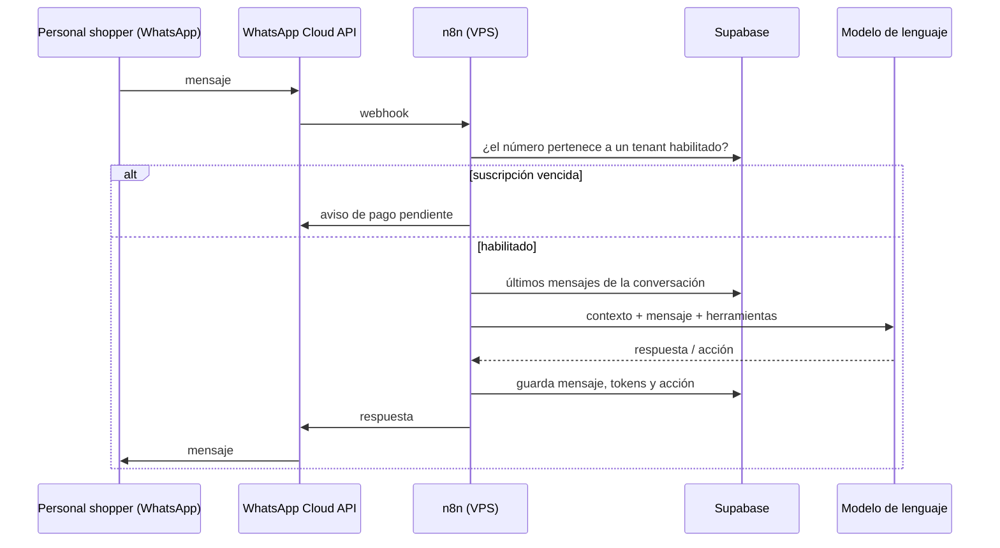
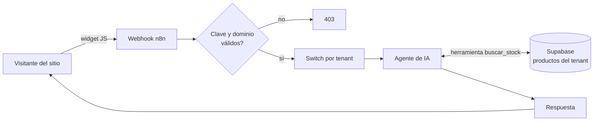

# Asistentes de IA multi-cliente con n8n y Supabase


> 🇬🇧 **English summary:** Two multi-tenant AI products built on self-hosted n8n and Supabase: (1) a WhatsApp assistant for personal shoppers, billed by Stripe subscription with automatic cut-off on non-payment, and (2) an embeddable website chatbot that answers stock and price questions from each store's own product database. Includes the multi-tenant schema with Row Level Security and the dependency-free chat widget.

**Estado:** en desarrollo. El asistente de WhatsApp está en fase de pruebas.

## Productos

### 1. Asistente de WhatsApp para personal shoppers

Las personal shoppers trabajan casi todo el día por WhatsApp. Este es un asistente personal y administrativo que funciona dentro de ese mismo canal: cada personal shopper es un cliente (tenant) del servicio, con su propia configuración y su propio historial.



### 2. Chatbot de stock para sitios web

Un comercio pega una línea de código en su web y sus visitantes pueden preguntar *"¿tienen 205/55 R16?"* y recibir precio y disponibilidad reales, sacados de la base de ese comercio. Casos de uso con los que se diseñó: una gomería (neumáticos y cambio de aceite) y un comercio de insumos médicos.



**Probalo:** abrí [`widget/demo.html`](widget/demo.html) en el navegador (funciona sin servidor, con un catálogo de ejemplo).

## Decisiones de arquitectura

| Decisión | Por qué |
|---|---|
| **n8n autoalojado en un VPS** | Costo fijo y predecible con muchos clientes; los workflows se pueden versionar y modificar sin redeploy. |
| **Una base, muchos clientes (multi-tenant)** con `tenant_id` en todas las tablas | Un solo esquema que mantener. Row Level Security asegura que un cliente nunca vea datos de otro, aunque haya un error en el código. |
| **El acceso depende de la suscripción** | n8n consulta la vista `tenants_habilitados` antes de llamar al modelo: si Stripe marca la suscripción como impaga, el servicio se corta solo, sin intervención manual. |
| **El modelo de IA no inventa stock** | El agente solo puede responder sobre productos que devuelve la función `buscar_stock`, siempre filtrada por tenant. |
| **Consumo de tokens registrado por mensaje** | La vista `consumo_mensual` permite controlar el costo de IA por cliente y detectar a quien consume más que lo que paga. |
| **Widget en Shadow DOM, sin dependencias** | Se instala con una línea, no rompe los estilos del sitio del cliente y no permite inyectar HTML desde las respuestas. |

## Qué hay en este repositorio

```
├── supabase/schema.sql      # tablas, vistas, función de búsqueda y políticas RLS
├── widget/
│   ├── chat-widget.js       # widget embebible (vanilla JS, Shadow DOM)
│   └── demo.html            # página de prueba con modo demo
└── workflows/               # workflows exportados de n8n (ver instrucciones)
```

## Diseño para escala

El objetivo de diseño es atender del orden de **100 clientes con unos 100 mensajes diarios cada uno** (~10.000 mensajes por día). Por eso:

- Los mensajes se indexan por conversación y fecha para traer solo los últimos N como contexto, en lugar de todo el historial.
- El switch por tenant en n8n permite dar a cada cliente su propio prompt y herramientas sin duplicar workflows.
- El consumo de tokens queda guardado para ajustar precios por plan con datos reales.

---
**Autor:** Luis Pérez · [LinkedIn](https://www.linkedin.com/in/perezluis24/) · Analista de Datos | BI | Automatización
